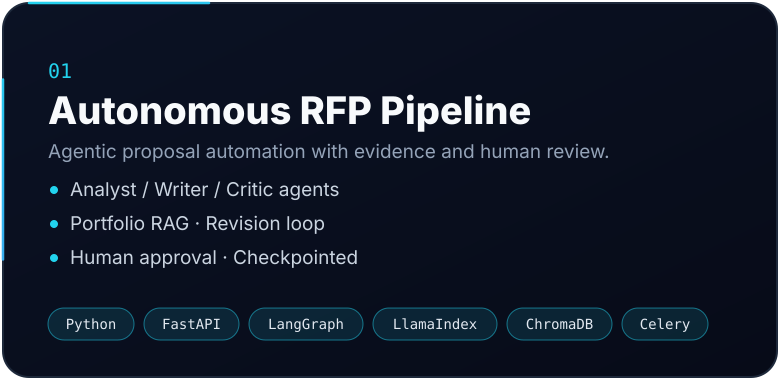
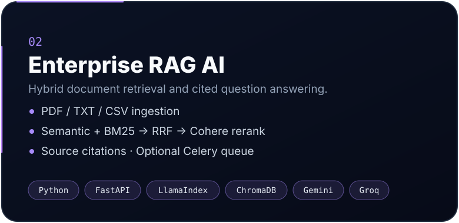
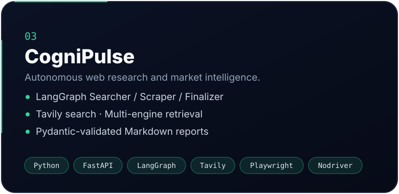
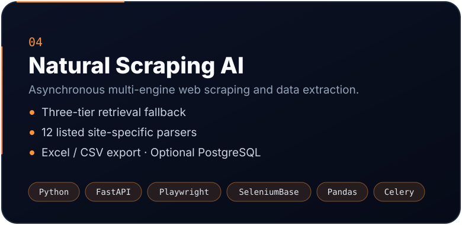
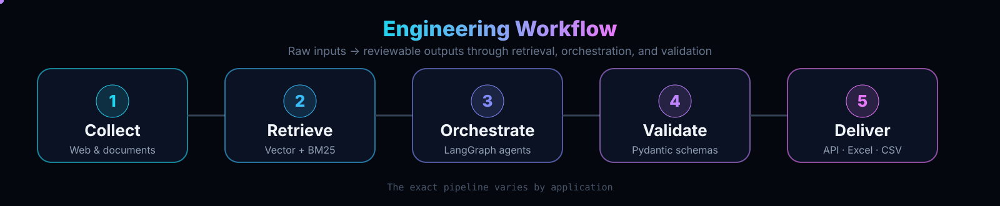

 

 

<!-- ADD LATER: LinkedIn and Portfolio SVG buttons after creating their SVG files.

-->

  

**Open to Junior / Associate Python Backend & Applied AI Opportunities**

Pakistan · Remote · Contract · Freelance

## About Me

I'm **Muhammad Faizan**, a Python Backend and Applied AI Developer focused on building practical AI-powered applications, agentic workflows, retrieval systems, and intelligent automation.

I work primarily with Python to connect LLMs, external data sources, retrieval pipelines, and backend services into complete application workflows.

My development approach focuses on **evidence-grounded outputs, structured validation, reliable processing, and practical business automation** rather than standalone chatbot demonstrations.

My primary engineering focus is Python backend development and AI pipelines. I also work with Next.js, React, and Tailwind CSS using AI-assisted frontend development workflows.

## What I Build

| Engineering Area | Practical Capabilities |
|:--|:--|
| **Agentic AI Systems** | LangGraph workflows, multi-agent coordination, tool calling, conditional routing, critique loops, MCP integrations, and human-in-the-loop approval. |
| **RAG & Document Intelligence** | Document ingestion, embeddings, vector retrieval, hybrid search, BM25, Reciprocal Rank Fusion, reranking, CRAG, and source-grounded responses. |
| **LLM Applications** | Model integrations, structured outputs, prompt engineering, response validation, guardrails, and model orchestration. |
| **Intelligent Web Automation** | Browser automation, multi-engine scraping, retrieval fallbacks, site-specific parsers, proxy rotation, and structured extraction. |
| **Python Backend Systems** | FastAPI services, Pydantic validation, asynchronous processing, Celery workers, Redis queues, and Docker-based environments. |
| **Data Processing** | Data extraction, cleaning, validation, transformation, and Excel / CSV report generation. |

## Technical Stack

**Languages & Backend**

Python · FastAPI · Pydantic v2 · Asyncio

**Agentic AI & LLM Engineering**

LangGraph · LangChain · LlamaIndex · CrewAI · MCP · Prompt Engineering

**LLMs & Model Providers**

OpenAI · OpenRouter · Groq · Gemini · Claude

**RAG, Retrieval & Evaluation**

ChromaDB · FAISS · BM25 · Hybrid Retrieval · CRAG · Cohere Reranking · Langfuse · DeepEval · Guardrails

**Web Scraping & Browser Automation**

Playwright · Selenium · SeleniumBase · Nodriver · BeautifulSoup4 · Proxy Rotation

**Infrastructure & Background Processing**

Docker · Redis · Celery · PostgreSQL

**Frontend & UI Integration**

Next.js · React · Tailwind CSS · AI-Assisted Frontend Development

## Selected Projects

Four independently developed projects demonstrating practical work across agentic AI, retrieval engineering, autonomous research, and browser automation.

<table>
<tr>
<td width="50%" align="center">

</td>
<td width="50%" align="center">

</td>
</tr>
<tr>
<td width="50%" align="center">

</td>
<td width="50%" align="center">

</td>
</tr>
</table>

 

### 01 · Autonomous RFP Pipeline

*Agentic proposal automation with portfolio evidence and human review.*

Transforms a public Request for Proposal (RFP) URL into a tailored proposal draft. The workflow extracts requirements, retrieves relevant portfolio knowledge, analyzes requirements, generates a proposal, performs independent AI critique, and pauses for human approval.

**Engineering Highlights**

- LangGraph-based multi-stage workflow orchestration.
- Portfolio RAG for evidence retrieval.
- Specialized Analyst, Writer, and Critic stages.
- Automated critique and revision loop.
- Human-in-the-loop approval checkpoint.
- Checkpointed workflow state and asynchronous task processing.

**Technology Stack**

Python · FastAPI · LangGraph · LlamaIndex · ChromaDB · Celery · Redis · Next.js

**Project Links**

[Repository](https://github.com/mrfaizan-dev/Autonomous-RFP-Pipeline) · [YouTube Demo](https://youtu.be/Bz_w748BjSg)

<!-- ADD LATER: Public frontend preview URL, if available.
[Frontend Preview](YOUR_RFP_FRONTEND_URL)
-->

---

### 02 · Enterprise RAG AI

*Hybrid document retrieval and source-cited question answering.*

An AI-powered document intelligence application that processes PDF, TXT, and CSV files into searchable knowledge. Combines semantic retrieval with BM25 keyword search, fuses results using Reciprocal Rank Fusion, and applies Cohere reranking to improve retrieved context for grounded answers.

**Engineering Highlights**

- Document ingestion and embedding pipelines.
- Semantic vector search with ChromaDB.
- BM25 keyword-based retrieval.
- Hybrid retrieval using Reciprocal Rank Fusion.
- Cohere reranking for context selection.
- Source-grounded answers with document citations.
- Optional asynchronous document processing.

**Technology Stack**

Python · FastAPI · LlamaIndex · ChromaDB · Gemini · Groq · Cohere · Celery · Redis

**Project Links**

[Repository](https://github.com/mrfaizan-dev/Enterprise-RAG-AI)

<!-- ADD LATER: [YouTube Demo](YOUR_ENTERPRISE_RAG_VIDEO_URL)
[Frontend Preview](YOUR_ENTERPRISE_RAG_FRONTEND_URL)
-->

---

### 03 · CogniPulse

*Autonomous web research and structured market intelligence.*

Transforms natural-language research questions into structured Markdown reports. Tavily discovers relevant public sources, a layered browser retrieval system extracts page content, and LLM-powered extraction produces structured information validated against Pydantic schemas.

**Engineering Highlights**

- LangGraph Searcher, Scraper, and Finalizer workflow.
- Tavily-powered web research and source discovery.
- Multi-engine browser retrieval and fallback handling.
- Playwright, SeleniumBase, and Nodriver integration.
- Pydantic-based structured extraction.
- Asynchronous research jobs and report generation.

**Technology Stack**

Python · FastAPI · LangGraph · Tavily · Playwright · SeleniumBase · Nodriver · Celery · Redis · Next.js

**Project Links**

[Repository](https://github.com/mrfaizan-dev/CogniPulse-AI-Market-Intelligence)

<!-- ADD LATER: [YouTube Demo](YOUR_COGNIPULSE_VIDEO_URL)
[Frontend Preview](YOUR_COGNIPULSE_FRONTEND_URL)
-->

---

### 04 · Natural Scraping AI

*Asynchronous multi-engine web scraping and structured data extraction.*

A web data extraction platform that processes e-commerce and real-estate URLs through browser automation, retrieval fallbacks, site-specific parsers, structured validation, and data cleaning.

Extracted results can be processed and exported into formatted Excel and CSV reports, with optional PostgreSQL storage.

**Engineering Highlights**

- Multi-engine browser automation and retrieval fallback.
- 12 site-specific parsers.
- Playwright, SeleniumBase, and Nodriver integration.
- Pydantic-based structured data validation.
- Pandas-powered data processing and cleaning.
- Celery-based background task tracking.
- Excel and CSV report generation.

**Technology Stack**

Python · FastAPI · Playwright · SeleniumBase · Nodriver · BeautifulSoup4 · Pandas · Celery · Redis · PostgreSQL · Docker

**Project Links**

[Repository](https://github.com/mrfaizan-dev/Natural-Scraping-AI)

<!-- ADD LATER: [YouTube Demo](YOUR_NATURAL_SCRAPING_VIDEO_URL)
[Frontend Preview](YOUR_NATURAL_SCRAPING_FRONTEND_URL)
-->

## From Data to Intelligence

## Engineering Principles

**01 · Evidence Before Generation**

Ground factual outputs in retrieved documents, indexed knowledge, or original source pages.

**02 · Structured Validation**

Use Pydantic schemas and validation layers to enforce predictable data structures and reduce unreliable outputs.

**03 · Resilient Workflows**

Account for retrieval failures, external service errors, retries, fallbacks, and long-running background tasks.

**04 · Reliable Backend Processing**

Use asynchronous APIs, background workers, and structured task handling where workloads should not block application requests.

**05 · Human Oversight**

Keep people involved in approval-sensitive workflows instead of automatically treating every AI-generated output as final.

**06 · Observability & Evaluation**

Use tracing and evaluation tools to inspect AI workflow execution and assess output quality.

## Working With Me

I'm interested in opportunities where Python backend engineering and Applied AI can solve practical business problems.

**Open to:**

- Junior / Associate Python Backend Developer roles.
- Applied AI / GenAI Developer opportunities.
- AI Agent and RAG Engineering work.
- Python Web Scraping and Automation projects.
- Remote, contract, internship, and freelance opportunities.

I enjoy building systems that combine reliable backend engineering with practical AI capabilities.

## Let's Connect

Have a Python backend, RAG, AI agent, or intelligent automation project?

Feel free to reach out.

<!-- ADD LATER: LinkedIn and portfolio buttons.

-->

  

