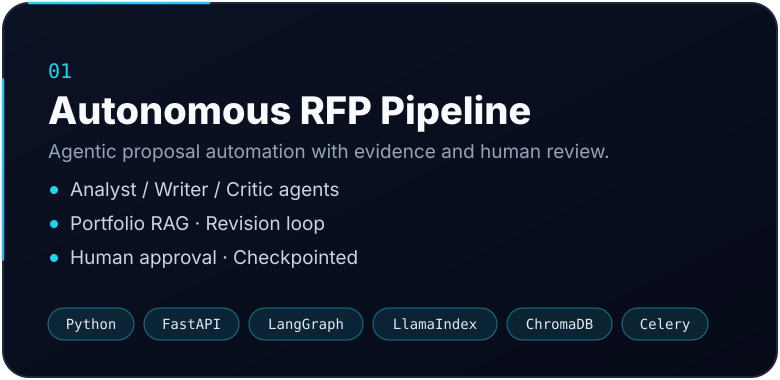
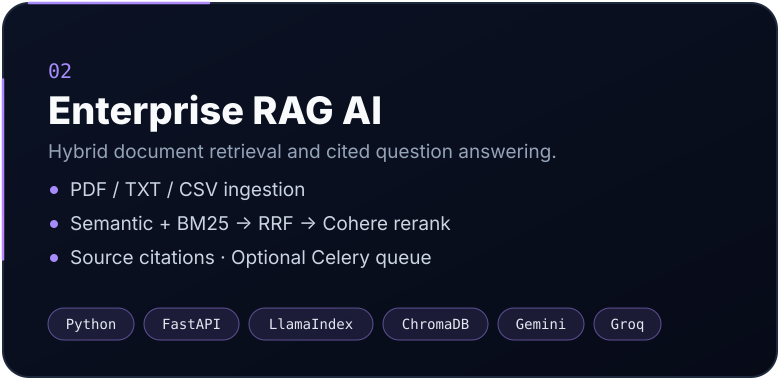
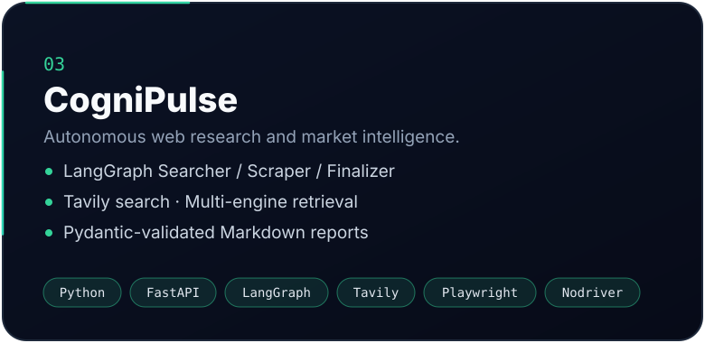
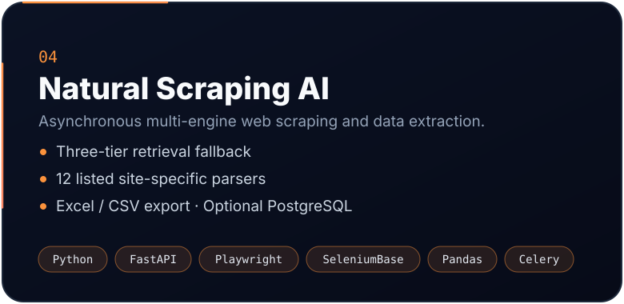
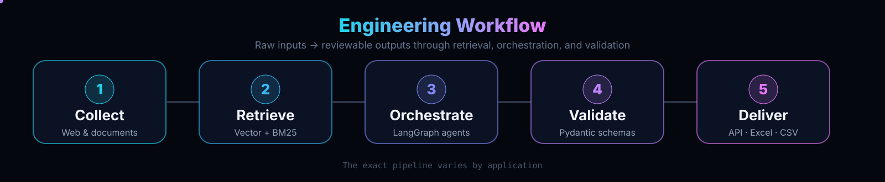

 

  

I build practical AI-powered systems that connect **LLMs, agent workflows, retrieval pipelines, browser automation, and Python backend services**.
My focus is turning unstructured web and document data into useful, validated outputs — not just standalone prompts or chat demos.

## About

I'm **Mr Faizan**, a Python Backend and Applied AI Developer. I design and build end-to-end applications across four connected areas:

- **Agentic AI** — multi-step workflows that coordinate specialized agents, tools, and model calls.
- **RAG and document intelligence** — retrieval systems that ground LLM responses in documents and indexed knowledge.
- **Web research and automation** — browser-based extraction pipelines that turn public web pages into structured information.
- **Backend and data engineering** — asynchronous APIs, background workers, validation, processing, and export pipelines.

My primary engineering focus is the Python backend and AI pipeline. I also build application interfaces with Next.js, React, and Tailwind CSS using AI-assisted frontend workflows.

## What I Build

| Focus | What it means in practice |
|:--|:--|
| **Agentic AI applications** | LangGraph workflows, tool use, multi-stage reasoning, independent review, and human approval checkpoints, MCP. |
| **RAG and knowledge systems** | Document ingestion, embeddings, vector retrieval, BM25, rank fusion, reranking, and source-grounded answers. |
| **Intelligent web automation** | Playwright/Selenium-based browser workflows, retrieval fallbacks, site-specific parsers, and structured extraction. |
| **Python backend systems** | FastAPI services, Pydantic validation, asyncio, Celery workers, Redis queues, and Docker-based deployment. |
| **Data products** | Cleaning and validating extracted information, then delivering it through APIs, dashboards, Excel, and CSV. |

## Selected Projects

<table>
<tr>
<td width="50%" align="center"></td>
<td width="50%" align="center"></td>
</tr>
<tr>
<td width="50%" align="center"></td>
<td width="50%" align="center"></td>
</tr>
</table>

<b>Full project details</b>

### 01 · Autonomous RFP Pipeline — *Agentic proposal automation with evidence and human review*
Turns a public RFP or project URL into a tailored proposal draft. The workflow extracts requirements, retrieves relevant portfolio evidence, drafts the response, sends it through an independent AI critique, and pauses for human approval.
**Highlights:** LangGraph orchestration · Portfolio RAG · Analyst / Writer / Critic agents · Revision loop · Human approval · Checkpointed workflow
**Stack:** Python · FastAPI · LangGraph · LlamaIndex · ChromaDB · Celery · Redis · Next.js
[Repository](https://github.com/mrfaizan-dev?tab=repositories) · [Live application (AegisIQ)](#)

### 02 · Enterprise RAG AI — *Hybrid document retrieval and cited question answering*
Turns PDF, TXT, and CSV files into searchable knowledge. Semantic retrieval and BM25 keyword search are combined with Reciprocal Rank Fusion, then Cohere reranking selects context for grounded LLM answers.
**Highlights:** Document ingestion · Gemini embeddings · ChromaDB · Hybrid retrieval · RRF · Cohere reranking · Source citations · Optional Celery queue
**Stack:** Python · FastAPI · LlamaIndex · ChromaDB · Gemini · Groq · Cohere · Celery · Redis

### 03 · CogniPulse — *Autonomous web research and market intelligence*
Converts a natural-language research question into a structured Markdown report. Tavily discovers relevant public URLs; a layered browser engine retrieves pages; LLM extraction is validated against Pydantic schemas.
**Highlights:** LangGraph Searcher / Scraper / Finalizer · Tavily search · Multi-engine retrieval · Structured extraction · Background research jobs
**Stack:** Python · FastAPI · LangGraph · Tavily · Playwright · SeleniumBase · Nodriver · Celery · Redis · Next.js

### 04 · Natural Scraping AI — *Asynchronous multi-engine web scraping and data extraction*
Processes e-commerce and real-estate URLs through browser automation, fallback retrieval, site-specific parsers, structured validation, and data cleaning. Results can be exported as formatted Excel and CSV files, with optional PostgreSQL storage.
**Highlights:** Three-tier retrieval fallback · 12 listed site-specific parsers · Pydantic models · Pandas processing · Celery task tracking · Downloadable reports
**Stack:** Python · FastAPI · Playwright · SeleniumBase · Nodriver · BeautifulSoup4 · Pandas · Celery · Redis · PostgreSQL · Docker

## Engineering Principles

- **Ground outputs in evidence** — use retrieved documents or source pages where the task requires factual answers.
- **Validate at system boundaries** — use schemas and structured models instead of trusting free-form model output.
- **Design for long-running work** — move scraping and research tasks into background workers when they should not block API requests.
- **Plan for retrieval failures** — use retries, fallbacks, and explicit error paths where external sites or services are unreliable.
- **Keep humans in control** — use review and approval checkpoints when generated content needs a person to make the final decision.

## Contact

I'm interested in connecting with teams working on Python backend engineering, Applied AI, agentic workflows, RAG systems, and intelligent automation.

